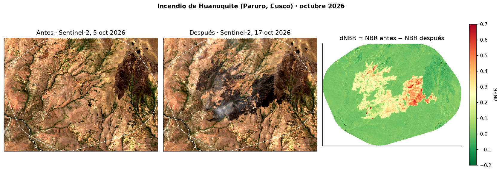
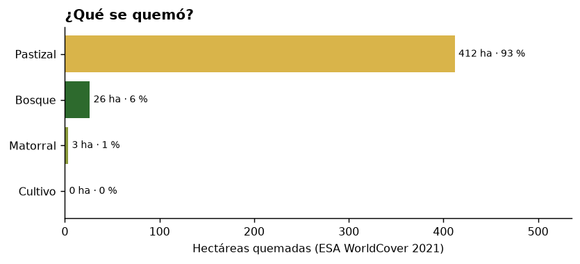
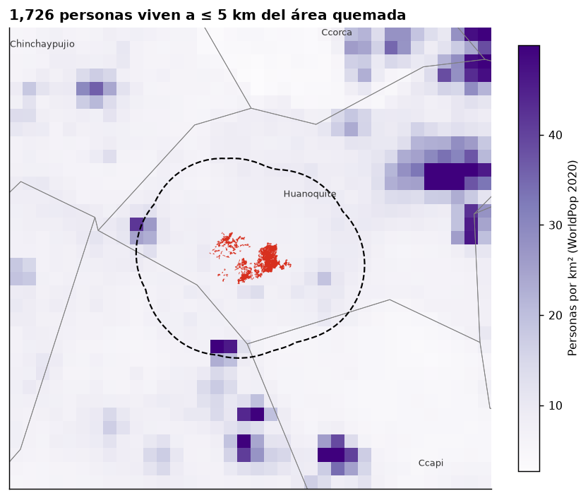
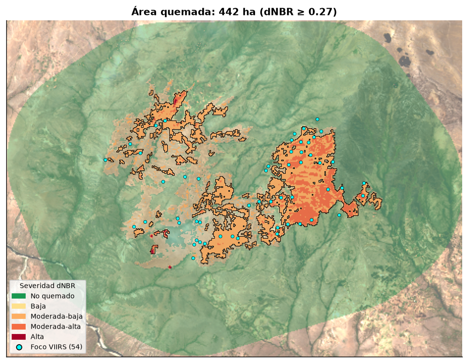
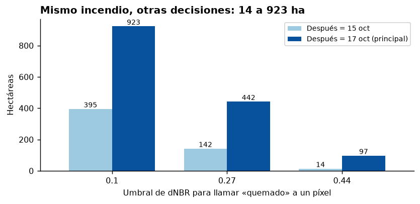

# 🔥 El incendio de Huanoquite: qué se quemó y a quién tocó

**Ciencia de Datos con Python · Sesión 07 (raster) · Tarea de incendios, octubre 2026**

Retos combinados: **A** (área quemada con dNBR) + **C** (¿qué se quemó?, WorldCover) + **D** (¿a quién afecta?, WorldPop) + dashboard en Streamlit.



## La pregunta

En octubre de 2026 el sur andino tuvo su temporada de incendios más intensa desde 2012. El de Curahuasi fue el más grande, así que elegí **el segundo incendio más grande de Apurímac y Cusco según los focos VIIRS: Huanoquite (provincia de Paruro, Cusco)**.

> ¿Cuántas hectáreas se quemaron, **qué** se quemó (bosque, pastizal o cultivo) y **cuánta gente** vive cerca?

## Tres hallazgos

1. **Se quemaron 442 ha** (dNBR ≥ 0,27) entre el 5 y el 17 de octubre. La mayoría es de severidad moderada-baja (345 ha) y moderada-alta (95 ha). Solo 1,5 ha alcanzan severidad alta.
2. **Ardió la puna, no el bosque:** el **93 % de lo quemado era pastizal** (412 ha), que es el forraje del ganado de las comunidades. Solo 26 ha eran bosque y menos de 1 ha cultivo. Con eso se quemó el 10 % de todo el pastizal de la zona de estudio.
3. **1 726 personas viven a menos de 5 km** del área quemada y **261 a menos de 1 km**, en tres distritos: Huanoquite, Ccapi (ambos de Paruro) y Tambobamba (Cotabambas, Apurímac).

Además, **el incendio se triplicó en dos días.** Con la imagen del 15 de octubre se miden 142 ha y con la del 17 de octubre, 442 ha.

| ¿Qué se quemó? | ¿A quién afecta? |
|---|---|
|  |  |



## Datos y fechas

| Dato | Fuente | Fecha | Tipo |
|---|---|---|---|
| Focos de calor | NASA FIRMS, VIIRS S-NPP y NOAA-20 (375 m), «South America 7d» | 14–20 oct 2026 | Puntos (CSV) |
| Límites distritales | INEI vía [juaneladio/peru-geojson](https://github.com/juaneladio/peru-geojson) | — | Polígonos |
| Imagen **antes** | Sentinel-2 L2A, tile 18LZK (Planetary Computer) | **5 oct 2026**, 0 % de nubes en la zona | Raster 20 m |
| Imagen **después** | Sentinel-2 L2A, tile 18LZK | **17 oct 2026**, 0 % de nubes en la zona | Raster 20 m |
| Imagen de sensibilidad | Sentinel-2 L2A, tile 18LZK | 15 oct 2026, 6 % de nubes | Raster 20 m |
| Cobertura del suelo | ESA WorldCover v200 (Planetary Computer) | 2021 | Raster 10 m |
| Población | WorldPop, conteos sin ajustar | 2020 | Raster 1 km |

Ninguna fuente pide clave ni pago, y todo corre en CPU.

## Método

1. **De focos a incendios** (`01`). Descarto los focos de confianza baja. Dos focos pertenecen al mismo incendio si están a ≤ 1 km y ≤ 48 h entre sí; los agrupo con un grafo y sus componentes conexas. Huanoquite es el incendio `42`, con 54 focos.
2. **Zona de estudio** (`02`). Es la envolvente convexa de los focos más un margen de 2 km, unas 4 931 ha. Para cada escena Sentinel-2 calculo el % de nubes **dentro de la zona** con la capa SCL, no el % de la escena completa. Así elegí las fechas: [`escenas_sentinel2.csv`](data/processed/escenas_sentinel2.csv).
3. **dNBR** (`03`). NBR = (B8A − B12)/(B8A + B12) a 20 m, después de aplicar el offset de −1000 de la línea base ≥ 04.00, y dNBR = NBR antes − NBR después. Enmascaro nubes, sombras, cirros, agua y píxeles sin dato en cualquiera de las dos fechas. Las clases de severidad siguen a Key & Benson (2006), y considero **quemado** un píxel con dNBR ≥ 0,27.
4. **Cruces** (`04`). Llevo WorldCover a la grilla de 20 m por **moda**, porque las categorías no se promedian. Para la población sumo WorldPop dentro de un radio de 5 km (y de 1 km) alrededor de los polígonos quemados.
5. **Mapas y dashboard** (`05`, `app.py`).

## ¿Cuánto se quemó? Depende de mis decisiones



| Imagen después | dNBR ≥ 0,10 | dNBR ≥ 0,27 (elegido) | dNBR ≥ 0,44 |
|---|---:|---:|---:|
| 17 oct | 923 ha | **442 ha** | 97 ha |
| 15 oct | 395 ha | 142 ha | 14 ha |

El mismo incendio da entre **14 y 923 ha** según la fecha y el umbral. Elegí el 17 de octubre porque era la imagen más tardía sin nubes. Elegí 0,27 porque el umbral de 0,10 incluye cambios leves, como pasto seco o sombras, que no son quema clara.

## Limitaciones

- **Un foco de calor no es un incendio**, y la huella VIIRS de 375 m no es el área quemada. Uso los focos para encontrar el incendio y el raster para medirlo.
- **El fuego seguía activo el 17 de octubre**: VIIRS lo detectó esa misma tarde, después del paso de Sentinel-2. El área final puede ser mayor. La imagen del 20 de octubre está 100 % nublada, así que no pude cerrar la medición.
- **Las nubes y el humo esconden el fuego.** Se ve humo en el sector oeste de la imagen del 17 de octubre. Eso puede bajar el dNBR y subestimar la severidad.
- **Había una quemadura previa** al este, ya visible el 5 de octubre. El dNBR no la cuenta, porque solo mide el cambio entre las dos fechas.
- Los umbrales de dNBR son genéricos, desarrollados en EE. UU., y no están calibrados con datos de campo en la puna.
- WorldCover es de 2021 y WorldPop de 2020, así que la cobertura y la población actuales pueden diferir. En la población a 5 km cuentan las celdas de 1 km cuyo centro cae dentro del radio.
- Es un ejercicio académico y no reemplaza los reportes del COEN, INDECI, SERFOR ni SERNANP.

## Cómo correrlo

```bash
python -m venv .venv
.venv\Scripts\activate            # Windows  (Linux/Mac: source .venv/bin/activate)
pip install -r requirements.txt

# El dashboard funciona directo con los resultados ya guardados en data/processed/
streamlit run app.py

# Para recalcular todo desde cero (FIRMS solo guarda 7 días: revisa INCENDIO_ID en src/config.py)
python src/00_descargar.py
python src/01_focos_incendios.py
python src/02_buscar_imagenes.py
python src/03_dnbr.py
python src/04_cruces.py
python src/05_mapas.py
```

Todas las decisiones de método (incendio, fechas, umbrales) están en [`src/config.py`](src/config.py).

```
├── app.py                  dashboard Streamlit
├── src/                    00–05: descarga → incendios → imágenes → dNBR → cruces → mapas
├── data/processed/         resultados (GeoTIFF, GeoJSON, CSV)
└── outputs/                mapas y gráficos (PNG)
```
